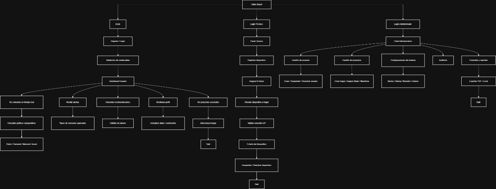
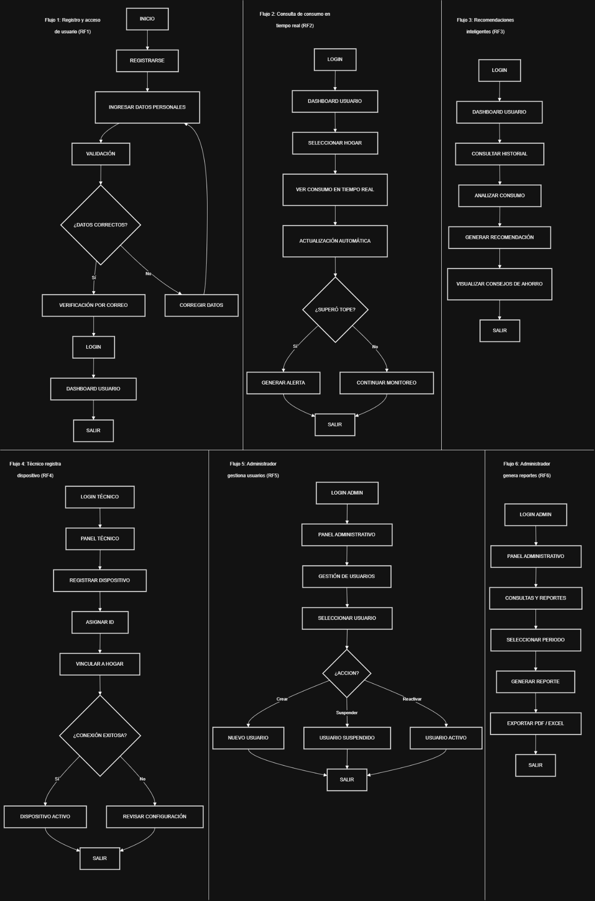

> **Nota de conversión y vigencia.** Este archivo conserva el contenido de su documento fuente convertido a Markdown. Las afirmaciones de diseño, alcance, roles, tecnologías y fechas pertenecen a esa fuente y no prueban el estado implementado. Para el corte técnico 2026-11-03 consulta la [documentación técnica vigente](../08_Documentacion_Tecnica_Actualizada/README.md) y el [resumen de fuentes y ramas](../08_Documentacion_Tecnica_Actualizada/01_Resumen_y_Arquitectura/00_Resumen_del_Sistema.md).

<strong>Diseño conceptual y arquitectura de información</strong>

<strong>Proyecto Hidro Smart</strong>

Emerson Calet Molano Cardozo

José Alejandro Montealegre Rodríguez

José David Amaya Mosquera

Instructor

Carlos Julio Cadena

Servicio Nacional de Aprendizaje SENA

Análisis y Desarrollo de Software ADSO

2026

<strong>Tabla de Contenido</strong>

Introducción    4

Mapa de navegación (Site Map)    5

Modelo de navegación implementado    5

Navegación jerárquica    6

Navegación modular    6

Navegación condicionada por permisos    6

Estructura principal del sistema    6

Pantalla de inicio    6

Panel principal (Dashboard dinámico)    7

Navegación por perfiles de usuario    7

Usuario final    7

Técnico    8

Administrador    8

Justificación de diseño UX/UI    9

Características técnicas de navegación    9

Relación con requerimientos funcionales    10

Flujos de usuario (User FlowS)    11

    11

Título Primer Nivel    12

Descripción de los Flujos de Usuario (User Flows)    12

Flujo 1: Registro y acceso de usuario (RF1)    13

Flujo 2: Consulta de consumo en tiempo real (RF2)    13

Flujo 3: Generación de recomendaciones inteligentes (RF3)    14

Flujo 4: Registro de dispositivo por técnico (RF4)    14

Flujo 5: Administración de usuarios (RF5)    15

Flujo 6: Generación de reportes administrativos (RF6)    15

Descripción de pantallas principales (Vinculadas a RF)    16

Explicación textual del flujo de navegación    19

Modelo de Navegación    20

Lógica de Transiciones Clave    20

Adaptación por Dispositivo    21

Plataforma Web    22

Seguridad en la Navegación (RF de Seguridad)    22

Referencias Bibliográficas    23

Control de actualización

<strong>Fecha de corte: 2026-10-09. Estado: Existente pero actualizado.</strong>

Fuente principal de esta actualización: Diseño Conceptual Y Arquitectura de Información.docx y PT\_HS.

Se conserva el modelo de navegación, pantallas, actores y flujos del documento original. La actualización añade una vista dinámica basada en la cadena real de autenticación, asociación, MQTT, ingestión y consulta.

Introducción

El presente documento de Diseño Conceptual y Arquitectura de Información tiene como propósito establecer la estructura lógica, organizacional y funcional del proyecto Hidro Smart, tomando como base los requerimientos definidos en el Documento de Especificación de Requisitos de Software (SRS) y en el análisis previo del sistema.

Durante esta fase se plantea la organización de la información, la distribución de módulos y la definición de los flujos de navegación necesarios para garantizar una interacción clara, eficiente e intuitiva entre los diferentes usuarios y el sistema. La arquitectura de información permite identificar cómo se relacionan los componentes funcionales de la aplicación, facilitando la comprensión de su funcionamiento y apoyando el posterior desarrollo e implementación.

Asimismo, se busca asegurar que la solución propuesta responda de manera adecuada a las necesidades operativas del proyecto, priorizando funcionalidades esenciales como el monitoreo en tiempo real, la gestión de alertas, el control de dispositivos, la administración de usuarios y la generación de reportes.

Como resultado de esta etapa se presentan los siguientes elementos:

 Mapa de navegación (Site Map): representación jerárquica de los módulos y secciones principales del sistema.

 Flujos de usuario (User Flows): secuencia de interacción para los procesos funcionales más relevantes.

 Descripción de pantallas principales: identificación de interfaces vinculadas a los requerimientos funcionales.

 Explicación textual del flujo de navegación: descripción de la lógica de acceso y transición entre funcionalidades.

Mapa de navegación (Site Map)

El Mapa de Navegación del sistema Hidro Smart representa la estructura jerárquica de las interfaces, módulos y rutas de interacción disponibles dentro de la plataforma, permitiendo visualizar de manera organizada el comportamiento general de navegación según cada tipo de usuario definido en el sistema.

Su propósito principal es establecer una visión estructural del acceso a funcionalidades, facilitando tanto el diseño de experiencia de usuario como la implementación técnica de los módulos de software.

El diseño del site map se fundamenta en una arquitectura modular y escalable, donde cada perfil de acceso dispone de funcionalidades específicas de acuerdo con sus responsabilidades dentro del sistema.Estructura principal (común a los roles)

Modelo de navegación implementado

La arquitectura de navegación del sistema responde a un modelo híbrido compuesto por tres enfoques principales:

Navegación jerárquica

Se establece un nodo principal de entrada desde el cual se distribuyen los diferentes caminos de acceso:

 Inicio

 Registro / autenticación

 Redirección por rol

Navegación modular

Cada panel organiza funciones relacionadas dentro de módulos independientes:

 monitoreo

 administración

 configuración

 control técnico

Navegación condicionada por permisos

La interfaz mostrada depende del rol autenticado en el sistema, garantizando seguridad y control de acceso.

Estructura principal del sistema

Pantalla de inicio

Constituye el punto inicial de acceso al sistema.

Incluye:

 autenticación de usuarios

 registro de nuevas cuentas

 validación de credenciales

Esta etapa corresponde al proceso inicial de control de acceso del sistema.

Panel principal (Dashboard dinámico)

Una vez validado el acceso, el sistema redirige automáticamente al panel correspondiente según el perfil autenticado.

Navegación por perfiles de usuario

Usuario final

El usuario dispone de un entorno orientado al monitoreo del consumo hídrico y control doméstico.

<strong>Funcionalidades principales</strong>

 visualización de consumo en tiempo real

 consulta de gráficos comparativos

 análisis por periodos:

 diario

 semanal

 mensual

 anual

 recepción de alertas automáticas

 consulta de recomendaciones inteligentes

 gestión de perfil

 selección de hogares asociados

<strong>Objetivo de navegación</strong>

Permitir acceso rápido a información crítica de consumo y toma de decisiones de ahorro.

Técnico

El técnico accede a un entorno orientado a la gestión operativa de dispositivos IoT.

<strong>Funcionalidades principales</strong>

 registro de dispositivos

 asignación de identificadores únicos

 vinculación de sensores a hogares

 validación de conectividad

 control de estado operativo

<strong>Objetivo de navegación</strong>

Facilitar procesos de instalación, activación y mantenimiento técnico.

Administrador

El administrador concentra la gestión global del sistema.

<strong>Funcionalidades principales</strong>

 gestión de usuarios

 administración de proyectos

 configuración general del sistema

 auditoría de operaciones

 generación de reportes

<strong>Objetivo de navegación</strong>

Garantizar control administrativo y supervisión integral de la plataforma.

Justificación de diseño UX/UI

El diseño de navegación fue estructurado bajo principios de usabilidad y eficiencia operativa.

<strong>Principios aplicados</strong>

 simplicidad visual

 agrupación funcional

 reducción de carga cognitiva

 consistencia estructural

<strong>Beneficios del diseño</strong>

 acceso intuitivo

 disminución de errores de navegación

 rápida localización de funciones críticas

 facilidad de escalabilidad futura

Características técnicas de navegación

<strong>Diseño adaptable</strong>

La estructura está preparada para entornos web responsivos.

<strong>Integración tecnológica</strong>

 Compatible con:

 servicios REST

 gestión de sesiones

 comunicación IoT

<strong>Escalabilidad</strong>

Permite incorporar nuevos módulos sin afectar la arquitectura existente.

Relación con requerimientos funcionales

La navegación del sistema responde directamente a los requerimientos funcionales establecidos en el SRS.

<strong>Usuario</strong>

 monitoreo

 alertas

 recomendaciones

 perfil

<strong>Técnico</strong>

 registro de dispositivos

 validación de conexión

<strong>Administrador</strong>

 usuarios

 proyectos

 auditoría

 reportes

Flujos de usuario (User FlowS) 

Título Primer Nivel

Descripción de los Flujos de Usuario (User Flows) 

Los Flujos de Usuario (User Flows) representan las principales secuencias de interacción entre los usuarios y el sistema Hidro Smart, describiendo cómo cada actor cumple sus objetivos dentro de la plataforma.

Cada flujo se encuentra alineado con un Requisito Funcional (RF) y fue diseñado siguiendo principios de:

 Usabilidad

 Experiencia de usuario (UX)

 Automatización de procesos

 Monitoreo inteligente del consumo hídrico

Flujo 1: Registro y acceso de usuario (RF1)

<strong>Escenario:</strong>

Un usuario doméstico crea una cuenta en la aplicación Hidro Smart y accede por primera vez al sistema para comenzar el monitoreo de consumo de agua.

<strong>Puntos clave:</strong>

 Registro guiado mediante ingreso de datos personales.

 Validación automática de información ingresada.

 Corrección inmediata en caso de errores detectados.

 Verificación de cuenta mediante correo electrónico.

 Acceso seguro al dashboard del usuario tras autenticación exitosa.

 Tiempo estimado de proceso: 1 – 2 minutos desde registro hasta acceso al sistema.

Flujo 2: Consulta de consumo en tiempo real (RF2)

<strong>Escenario:</strong>

Un usuario autenticado consulta el consumo de agua de su hogar desde la aplicación móvil para monitorear su gasto diario.

<strong>Puntos clave:</strong>

 Acceso directo desde el dashboard principal.

 Selección del hogar asociado al usuario.

 Visualización del consumo en tiempo real proveniente del dispositivo IoT.

 Actualización automática de datos sin intervención manual.

 Evaluación automática de límites de consumo configurados.

 Generación de alertas inmediatas cuando se supera el umbral definido.

 Continuidad del monitoreo en segundo plano.

Tiempo objetivo: menos de 10 segundos para visualizar datos actualizados.

Flujo 3: Generación de recomendaciones inteligentes (RF3)

<strong>Escenario:</strong>

El usuario revisa recomendaciones personalizadas para reducir su consumo de agua basadas en su historial de uso.

<strong>Puntos clave:</strong>

 Consulta del historial de consumo desde el dashboard.

 Análisis automático de patrones de uso.

 Generación de recomendaciones inteligentes de ahorro.

 Presentación visual de consejos prácticos al usuario.

 Apoyo a la toma de decisiones sostenibles.

 Mejora progresiva del comportamiento de consumo.

Flujo 4: Registro de dispositivo por técnico (RF4)

<strong>Escenario:</strong>

Un técnico instala y configura un dispositivo Hidro Smart en el hogar del usuario.

<strong>Puntos clave:</strong>

 Acceso mediante autenticación técnica.

 Registro del nuevo dispositivo dentro del sistema.

 Asignación de identificador único (ID).

 Vinculación del dispositivo con el hogar del usuario.

 Validación automática de conexión del dispositivo IoT.

 Activación del dispositivo tras conexión exitosa.

 Flujo alternativo para revisión de configuración en caso de fallo.

Tiempo estimado de instalación digital: 3 – 5 minutos.

Flujo 5: Administración de usuarios (RF5)

<strong>Escenario:</strong>

Un administrador gestiona los usuarios registrados dentro del sistema desde el panel administrativo.

<strong>Puntos clave:</strong>

 Acceso al panel administrativo mediante credenciales seguras.

 Visualización del listado de usuarios.

 Selección individual de usuarios.

 Acciones disponibles:

 Crear nuevo usuario.

 Suspender usuario.

 Reactivar usuario.

 Actualización inmediata del estado del usuario dentro del sistema.

 Control centralizado de acceso a la plataforma.

Flujo 6: Generación de reportes administrativos (RF6)

<strong>Escenario:</strong>

Un administrador genera reportes de consumo hídrico para análisis institucional o toma de decisiones.

<strong>Puntos clave:</strong>

 Acceso a módulo de consultas y reportes.

 Selección de periodo de análisis.

 Generación automática de reportes estadísticos.

 Exportación de información en formatos PDF y Excel.

 Apoyo a análisis de consumo y estrategias de ahorro hídrico.

Tiempo objetivo: menos de 15 segundos para generación del reporte.

Descripción de pantallas principales (Vinculadas a RF)

<table>
<tr>
<td>
Pantalla
</td>
<td>
RF Relacionado
</td>
<td>
Componentes Claves
</td>
<td>
Funcionalidad
</td>
</tr>
<tr>
<td>
Inicio
</td>
<td>
----
</td>
<td>
Logo del sistema, botones Iniciar sesi&#243;n / Registrarse
</td>
<td>
Acceso inicial al sistema
</td>
</tr>
<tr>
<td>
Login Usuario
</td>
<td>
RF1
</td>
<td>
Correo electr&#243;nico, contrase&#241;a, recuperaci&#243;n de contrase&#241;a
</td>
<td>
Autenticaci&#243;n segura de usuarios
</td>
</tr>
<tr>
<td>
Registro Usuario
</td>
<td>
RF1
</td>
<td>
Formulario de registro, validaci&#243;n de datos, verificaci&#243;n por correo
</td>
<td>
Creaci&#243;n de cuenta
</td>
</tr>
<tr>
<td>
Dashboard Usuario
</td>
<td>
RF2, RF3
</td>
<td>
Resumen de consumo, alertas, accesos r&#225;pidos, hogares asociados
</td>
<td>
Vista general del consumo h&#237;drico
</td>
</tr>
<tr>
<td>
Consumo en Tiempo Real
</td>
<td>
RF2
</td>
<td>
Gr&#225;ficas din&#225;micas, indicadores de consumo, rangos diario/semanal/mensual/anual
</td>
<td>
Monitoreo en tiempo real
</td>
</tr>
<tr>
<td>
Alertas y Notificaciones
</td>
<td>
RF2
</td>
<td>
Lista de alertas, estado de consumo, avisos autom&#225;ticos
</td>
<td>
Prevenci&#243;n de sobreconsumo
</td>
</tr>
<tr>
<td>
Recomendaciones Inteligentes
</td>
<td>
RF3
</td>
<td>
Consejos de ahorro, an&#225;lisis hist&#243;rico
</td>
<td>
Optimizaci&#243;n del uso del agua
</td>
</tr>
<tr>
<td>
Gesti&#243;n de Perfil
</td>
<td>
RF1
</td>
<td>
Actualizar datos personales, cambio de contrase&#241;a
</td>
<td>
Administraci&#243;n de cuenta
</td>
</tr>
<tr>
<td>
Proyectos / Hogares Asociados
</td>
<td>
RF2
</td>
<td>
Lista de hogares, selecci&#243;n de hogar
</td>
<td>
Gesti&#243;n de entornos monitoreados
</td>
</tr>
<tr>
<td>
Login T&#233;cnico
</td>
<td>
RF4
</td>
<td>
Usuario t&#233;cnico, contrase&#241;a
</td>
<td>
Acceso al panel t&#233;cnico
</td>
</tr>
<tr>
<td>
Panel T&#233;cnico
</td>
<td>
RF4
</td>
<td>
Registro de dispositivo, asignaci&#243;n ID
</td>
<td>
Configuraci&#243;n de dispositivos IoT
</td>
</tr>
<tr>
<td>
Registro de Dispositivo
</td>
<td>
RF4
</td>
<td>
ID &#250;nico, vinculaci&#243;n a hogar
</td>
<td>
Instalaci&#243;n digital del sensor
</td>
</tr>
<tr>
<td>
Estado del Dispositivo
</td>
<td>
RF4
</td>
<td>
Estado conexi&#243;n IoT, activar/suspender dispositivo
</td>
<td>
Control operativo del dispositivo
</td>
</tr>
<tr>
<td>
Login Administrador
</td>
<td>
RF5, RF6
</td>
<td>
Credenciales administrativas
</td>
<td>
Acceso administrativo
</td>
</tr>
<tr>
<td>
Panel Administrativo
</td>
<td>
RF5, RF6
</td>
<td>
Men&#250; administrativo general
</td>
<td>
Control total del sistema
</td>
</tr>
<tr>
<td>
Gesti&#243;n de Usuarios
</td>
<td>
RF5
</td>
<td>
Crear, suspender, reactivar usuarios
</td>
<td>
Administraci&#243;n de accesos
</td>
</tr>
<tr>
<td>
Gesti&#243;n de Proyectos
</td>
<td>
RF5
</td>
<td>
Crear hogar, asignar titular y miembros
</td>
<td>
Organizaci&#243;n del sistema
</td>
</tr>
<tr>
<td>
Configuraci&#243;n del Sistema
</td>
<td>
RF6
</td>
<td>
Idioma, moneda, alertas, colores
</td>
<td>
Personalizaci&#243;n global
</td>
</tr>
<tr>
<td>
Auditor&#237;a
</td>
<td>
RF6
</td>
<td>
Registro de acciones del sistema
</td>
<td>
Seguimiento y control
</td>
</tr>
<tr>
<td>
Consultas y Reportes
</td>
<td>
RF6
</td>
<td>
Filtros, generaci&#243;n de reportes
</td>
<td>
An&#225;lisis administrativo
</td>
</tr>
<tr>
<td>
Exportaci&#243;n de Reportes
</td>
<td>
RF6
</td>
<td>
Exportar PDF / Excel
</td>
<td>
Generaci&#243;n de informes
</td>
</tr>
</table>

Explicación textual del flujo de navegación

La navegación del sistema Hidro Smart sigue un modelo híbrido orientado a roles, diseñado para garantizar accesibilidad, eficiencia operativa y control seguro de las funcionalidades del sistema.

El diseño combina:

 Navegación jerárquica, donde el Dashboard actúa como centro principal de operaciones.

 Acceso directo a funciones críticas como monitoreo de consumo, gestión de dispositivos y generación de reportes.

Este enfoque permite reducir el número de pasos necesarios para ejecutar tareas frecuentes y mejora la experiencia del usuario en entornos móviles y web.

Modelo de Navegación

<strong>Navegación Jerárquica</strong>

El sistema organiza las funcionalidades desde pantallas principales hacia módulos especializados:

 Inicio → Autenticación → Panel correspondiente según rol.

 Dashboard como punto central de interacción.

 Submódulos accesibles mediante menús contextuales.

El flujo se adapta dinámicamente según el tipo de usuario:

 Usuario doméstico

 Técnico instalador

 Administrador del sistema

Lógica de Transiciones Clave

1\. <strong>Inicio → Login → </strong><strong>Dashboard</strong>

El usuario ingresa sus credenciales y, tras validación exitosa, accede al panel correspondiente. (RF1 – Autenticación y acceso seguro).

2\. <strong>Dashboard</strong><strong> Usuario → Consumo en Tiempo Real</strong>

El usuario consulta métricas actualizadas provenientes del dispositivo IoT instalado en el hogar. (RF2 – Monitoreo de consumo hídrico).

3\. <strong>Consumo → Alertas Automáticas</strong>

Cuando el sistema detecta valores superiores al umbral configurado, se generan notificaciones automáticas visibles desde el dashboard. (RF2 – Sistema de alertas inteligentes).

4\. <strong>Dashboard</strong><strong> → Recomendaciones Inteligentes</strong>

El usuario accede a sugerencias generadas a partir del análisis histórico de consumo. (RF3 – Optimización del uso del agua).

5\. <strong>Panel Técnico → Registro de Dispositivo → Validación </strong><strong>IoT</strong>

El técnico registra un dispositivo, asigna un identificador único y valida su conexión con el sistema. (RF4 – Gestión de dispositivos IoT).

6\. <strong>Panel Administrativo → Gestión del Sistema</strong>

El administrador gestiona usuarios, proyectos, configuraciones globales y reportes institucionales. (RF5 y RF6 – Administración y análisis del sistema).

Adaptación por Dispositivo

<strong>Dispositivos Móviles</strong>

La navegación prioriza rapidez y accesibilidad mediante:

 Menú inferior persistente:

 Dashboard

 Consumo

 Alertas

 Perfil

Optimizado para monitoreo continuo y consulta rápida.

Plataforma Web

Se emplea navegación estructurada para operaciones avanzadas:

 Menú superior para usuarios domésticos.

 Menú lateral administrativo para técnicos y administradores.

 Uso de breadcrumb navigation para mantener la referencia jerárquica dentro del sistema.

Seguridad en la Navegación (RF de Seguridad)

El sistema implementa mecanismos de protección durante toda la navegación:

 Comunicación segura mediante HTTPS obligatorio.

 Expiración automática de sesión tras 15 minutos de inactividad.

 Control de acceso basado en roles:

 Usuario

 Técnico

 Administrador

 Restricción automática de módulos según permisos asignados.

 Validación continua del estado de autenticación.

Referencias Bibliográficas

Bahga, A., &amp; Madisetti, V. (2014). <em>Internet </em><em>of</em><em>Things</em><em>: A </em><em>hands-on</em><em>approach</em>. Universities Press.

Garrett, J. J. (2010). <em>The </em><em>elements</em><em>of</em><em> user </em><em>experience</em><em>: User-</em><em>centered</em><em>design</em><em>for</em><em>the</em><em> web and </em><em>beyond</em> (2nd ed.). New Riders.

International Organization for Standardization. (2018). <em>ISO/IEC/IEEE 29148:2018 </em><em>systems</em><em> and software </em><em>engineering</em><em> — Life </em><em>cycle</em><em>processes</em><em> — </em><em>Requirements</em><em>engineering</em>. ISO.

Krug, S. (2014). <em>Don’t</em><em>make</em><em> me </em><em>think</em><em>: A </em><em>common</em><em>sense</em><em>approach</em><em>to</em><em> web </em><em>usability</em> (3rd ed.). New Riders.

Morville, P., &amp; Rosenfeld, L. (2015). <em>Information</em><em>architecture</em><em>for</em><em>the</em><em> web and </em><em>beyond</em> (4th ed.). O’Reilly Media.

National Institute of Standards and Technology. (2020). <em>Digital </em><em>identity</em><em>guidelines</em><em> (NIST Special </em><em>Publication</em><em> 800-63)</em>. https://doi.org/10.6028/NIST.SP.800-63

Nielsen Norman Group. (2020). <em>User </em><em>experience</em><em>basics</em>. [https://www.nngroup.com](https://www.nngroup.com)

OWASP Foundation. (2021). <em>OWASP top 10: The ten </em><em>most</em><em>critical</em><em> web </em><em>application</em><em>security</em><em>risks</em>. [https://owasp.org/www-project-top-ten/](https://owasp.org/www-project-top-ten/)

Pressman, R. S., &amp; Maxim, B. R. (2019). <em>Software </em><em>engineering</em><em>: A </em><em>practitioner’s</em><em>approach</em> (9th ed.). McGraw-Hill Education.

Sommerville, I. (2016). <em>Software </em><em>engineering</em> (10th ed.). Pearson Education Limited.

Anexo de actualización 2026: vistas dinámicas verificadas

El documento conceptual original se conserva como base de navegación y análisis. Este anexo incorpora la dinámica observada en el repositorio, diferenciando la interacción del usuario de la cadena IoT.

Flujo autenticación → autorización

Registro crea cuenta pendiente; verificación de correo habilita el ingreso.

Registro crea cuenta pendiente; verificación de correo habilita el ingreso.

Login entrega sesión/JWT; rutas protegidas usan Bearer.

Login entrega sesión/JWT; rutas protegidas usan Bearer.

Refresh intenta renovar una vez ante 401; logout revoca la sesión.

Refresh intenta renovar una vez ante 401; logout revoca la sesión.

Roles y restricciones de hogar/RLS limitan el acceso a datos.

Roles y restricciones de hogar/RLS limitan el acceso a datos.

Flujo dispositivo → telemetría → pantalla

El ESP32 mide pulsos/flujo y publica telemetry en hidrosmart/devices/{deviceCode}/telemetry.

El ESP32 mide pulsos/flujo y publica telemetry en hidrosmart/devices/{deviceCode}/telemetry.

MqttSubscriber recibe; parser y handler validan, normalizan y deduplican.

MqttSubscriber recibe; parser y handler validan, normalizan y deduplican.

La lectura se persiste en PostgreSQL; los agregados se consultan mediante API.

La lectura se persiste en PostgreSQL; los agregados se consultan mediante API.

El frontend actualiza la información mediante polling HTTP documentado de 5 segundos; no se afirma WebSocket push.

El frontend actualiza la información mediante polling HTTP documentado de 5 segundos; no se afirma WebSocket push.

Estado de las vistas originales

<table>
<tr>
<td>
<strong>Vista / artefacto original</strong>
</td>
<td>
<strong>Clasificaci&#243;n</strong>
</td>
<td>
<strong>Actualizaci&#243;n</strong>
</td>
</tr>
<tr>
<td>
Modelo de navegaci&#243;n y pantallas
</td>
<td>
Existente y vigente con ajustes
</td>
<td>
Se conserva; se a&#241;ade WebView/BLE m&#243;vil y estado real de m&#243;dulos.
</td>
</tr>
<tr>
<td>
Flujos de usuario
</td>
<td>
Existente pero desactualizado en tecnolog&#237;a
</td>
<td>
Se conserva; se corrige React Native puro/WebSocket por web + WebView/polling.
</td>
</tr>
<tr>
<td>
Secuencia IoT
</td>
<td>
Existente pero desactualizada
</td>
<td>
Se alinea con topics, QoS, retain, parser, ingesti&#243;n y PostgreSQL.
</td>
</tr>
<tr>
<td>
Actores y roles
</td>
<td>
Existente y vigente
</td>
<td>
Se contrasta con usuarios, admin, soporte y permisos de backend.
</td>
</tr>
</table>

