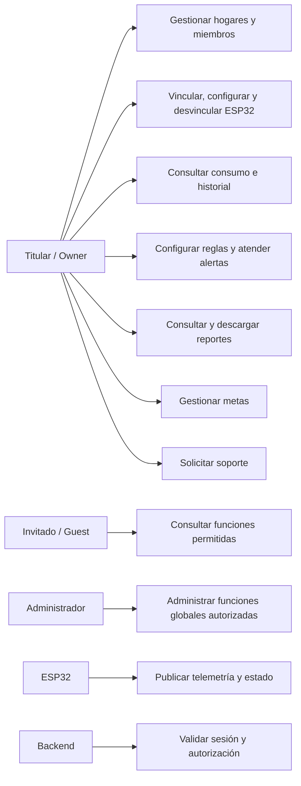

# Casos de uso

Actores funcionales y casos que aparecen en la copia integrada. El Draw.io
editable está en [Diagramas de Casos de Uso.drawio](Diagramas%20de%20Casos%20de%20Uso.drawio).

- **Titular / Owner:** administra hogares, membresías y funciones concedidas.
- **Invitado / Guest:** solo ejecuta acciones permitidas por su membresía.
- **Administrador:** opera las funciones globales permitidas al rol en el backend.
- **ESP32:** actor técnico de provisioning y telemetría.

El dibujo no especifica todos los endpoints ni concede permisos por sí mismo. El
backend y la base de datos verifican acceso. Las pantallas visibles pueden variar
según el rol y el cliente; soporte se encuentra dentro de Configuración en el
flujo móvil documentado.
