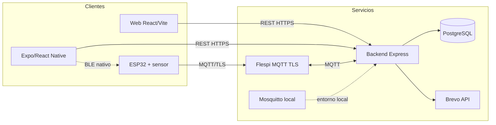

# Diagrama de componentes

Vista lógica de la integración descrita por los checkouts locales al 2026-11-03.
El archivo editable es [Diagrama_Componentes.drawio](Diagrama_Componentes.drawio).

| Componente | Responsabilidad |
| --- | --- |
| Web | Presentación y solicitudes REST. |
| Cliente Expo | Cliente móvil; el aprovisionamiento BLE requiere build nativo y soporte BLE. |
| ESP32 / caudalímetro | Pulsos, caudal, Wi-Fi, provisioning BLE y mensajes MQTT. |
| Backend | Sesión, CSRF, permisos, lógica del dominio, ingesta MQTT, alertas y correo. |
| PostgreSQL | Persistencia, funciones, roles y RLS administrados por Liquibase. |
| Flespi | Broker MQTT TLS externo documentado para la integración. |
| Mosquitto | Broker incluido en el entorno Docker local; no debe etiquetarse como broker de producción. |
| Brevo | Servicio HTTP de correo transaccional. |

## Diferencias entre las copias

PT_HS/hu-19-dev contiene cuatro códigos lógicos reconocidos por firmware/SQL integrado; el firmware publica cada lectura solo bajo el código activo y no representa cuatro sensores simultáneos. BD_HS/hu-23-dev separado reserva tres por SQL. BK_HS/hu-15-dev, FT_HS/hu-16-staging y Firmaware_HS/hu-03-dev no están en la misma rama/revisión. La versión de firmware separada no refleja todo lo presente en el firmware integrado. Esta diferencia impide presentar los repositorios separados como una release sincronizada.

El deviceCode identifica el dispositivo lógico vinculado a un hogar; el hardwareId identifica la placa. El diagrama representa arquitectura de código, no una prueba de que las ACL, el token Flespi o una placa estén activos.
