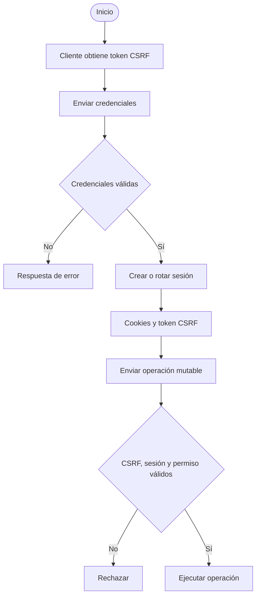
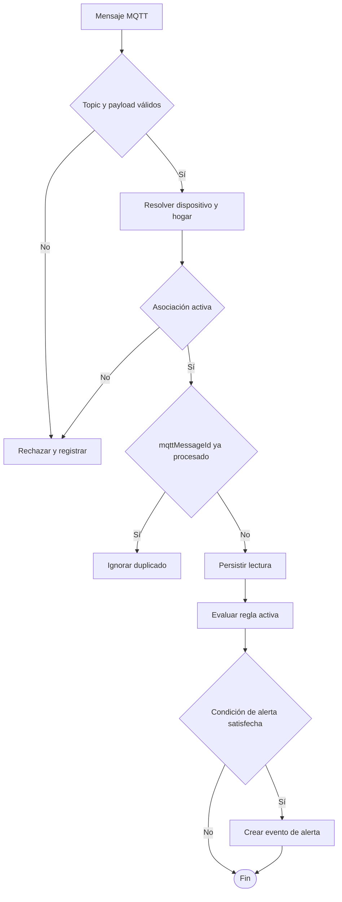

# Diagramas de actividades

El Draw.io contiene flujos de autenticación y procesamiento de MQTT:
[Diagramas de Actividades.drawio](Diagramas%20de%20Actividades.drawio).

## Autenticación y solicitud mutable

## Ingesta y alerta

El flujo depende de una regla activa y de migraciones compatibles; revisar el
código y la BD de la rama desplegada antes de asumir que una alerta se generó.
