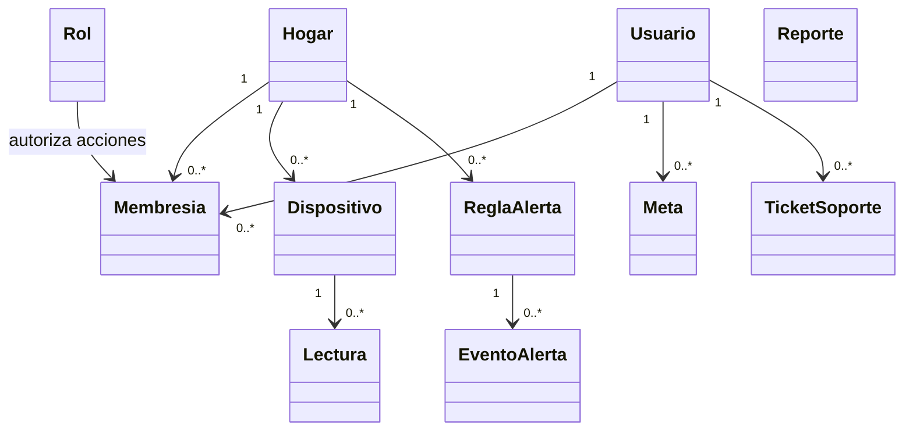

# Diagrama de dominio

El archivo editable es [diagrama de dominio.drawio](diagrama%20de%20dominio.drawio).
Esta vista de negocio no pretende reemplazar el MER físico.

La cardinalidad mostrada es conceptual y debe cotejarse con el MER/Liquibase
antes de usarla como esquema físico. Las tablas completas están en el
[diccionario implementado](../../08_Documentacion_Tecnica_Actualizada/03_Base_de_Datos/09_diccionario-implementado.md).
La rama de integración PT_HS/hu-19-dev y la base separada BD_HS/hu-23-dev
tienen inventarios distintos; esta vista no afirma que cada relación esté
aplicada en Neon.
