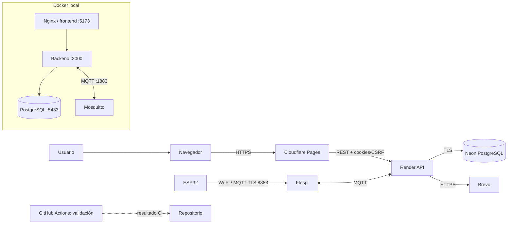

# Diagrama de despliegue

El Draw.io editable es [Diagrama_Despliegue.drawio](Diagrama_Despliegue.drawio).
El esquema separa servicios externos descritos por la configuración de la pila
de desarrollo local.

## Nube documentada

- Frontend: Cloudflare Pages en https://pt-hs.pages.dev.
- Backend: Render en https://pt-hs.onrender.com.
- PostgreSQL administrado: Neon con SSL.
- MQTT: Flespi en mqtt.flespi.io:8883 con TLS y ACL declaradas para los topics necesarios.
- Correo transaccional: API HTTPS de Brevo.
- ESP32: Wi-Fi para MQTT; BLE para el aprovisionamiento local.

## Desarrollo local

Compose contiene frontend/Nginx en 5173, backend en 3000, PostgreSQL en 5433,
Mosquitto en 1883 y Liquibase tooling. Los puertos publicados en loopback son
útiles para servicios del equipo local, pero la placa física no puede resolver
el DNS interno de Docker. Debe apuntar a un host/puerto alcanzable desde su LAN
cuando se usa un broker local.

## CI y límites de despliegue

El workflow de GitHub Actions valida el repositorio según su configuración; no
se debe asumir que un check de CI despliega la aplicación. La publicación en
Pages/Render depende de la integración y configuración del proveedor. La
documentación no confirma la rama, el directorio raíz ni los secretos que están
configurados actualmente en Cloudflare o Render.

Las direcciones muestran configuración documentada, no monitoreo de
disponibilidad. Verifica los paneles de los proveedores antes de afirmar que la
release está activa.
