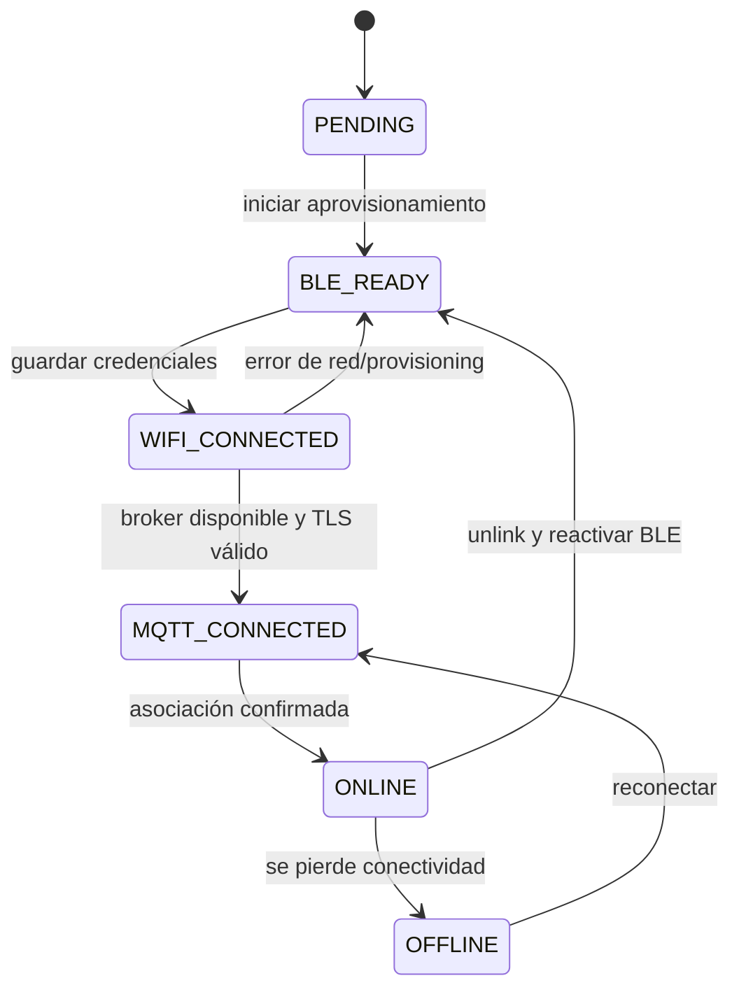
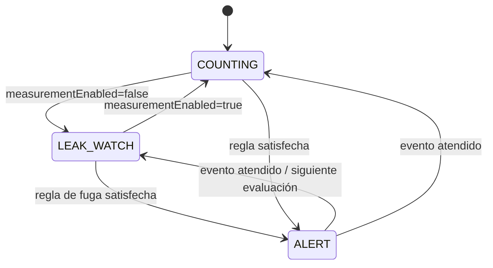

# Transición de estados

El [Draw.io editable](diagrama%20de%20trancicion%20de%20estados.drawio) tiene dos
páginas: conectividad/provisioning y medición/vigilancia.

## Conectividad del dispositivo

## Medición y vigilancia

El estado LEAK_WATCH mantiene el sensor, ESP32, Wi-Fi y MQTT activos; la suma de
litros se pausa mientras el caudal y los pulsos siguen disponibles para evaluar
fugas. Los nombres de provisioning son aproximados al contrato del monorepo y
deben verificarse contra la versión del firmware que se programe. El flujo de
unlink no implica que el dispositivo borre sus credenciales Wi-Fi.
