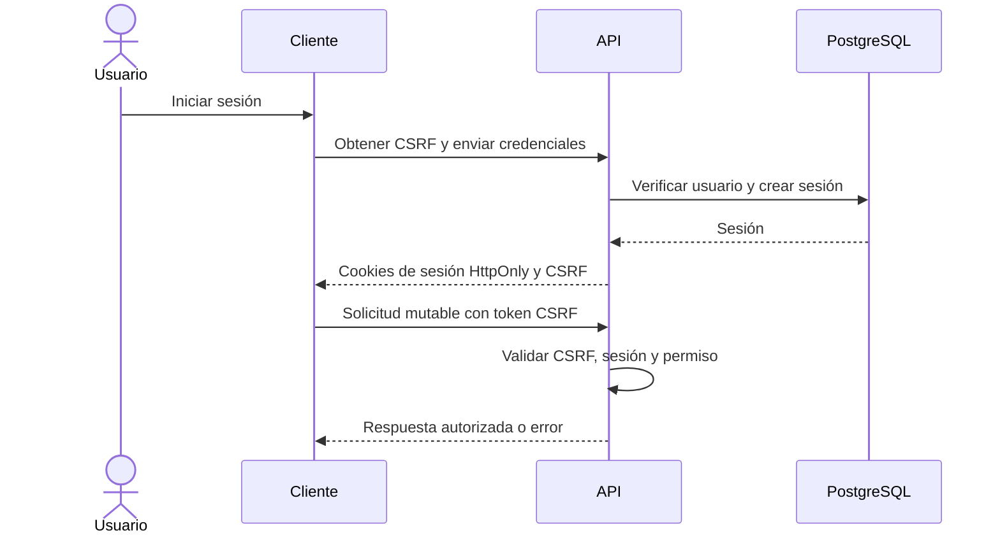
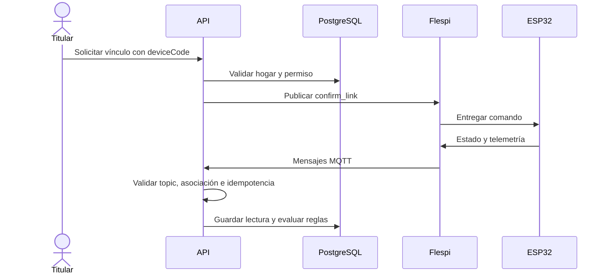
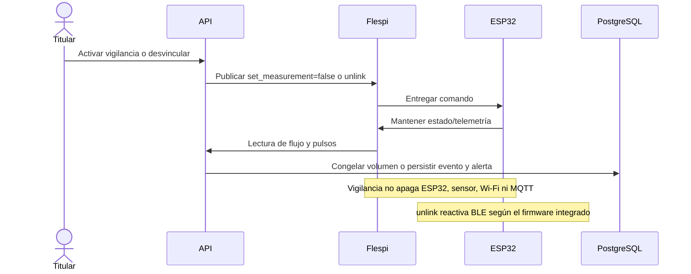

# Diagramas de secuencia

Tres flujos están disponibles en el [Draw.io editable](Diagramas%20de%20Secuencia.drawio):
autenticación, vinculación/ingesta y vigilancia de fuga/desvinculación.

## Sesión y CSRF

## Vincular ESP32 e ingestar MQTT

## Vigilancia y desvinculación

Los mensajes dependen de conexión, ACL y firmware compatible. El intervalo
esperado de telemetría es de cinco segundos, no una garantía de entrega. Estos
diagramas describen contratos y no prueban una instalación física.
