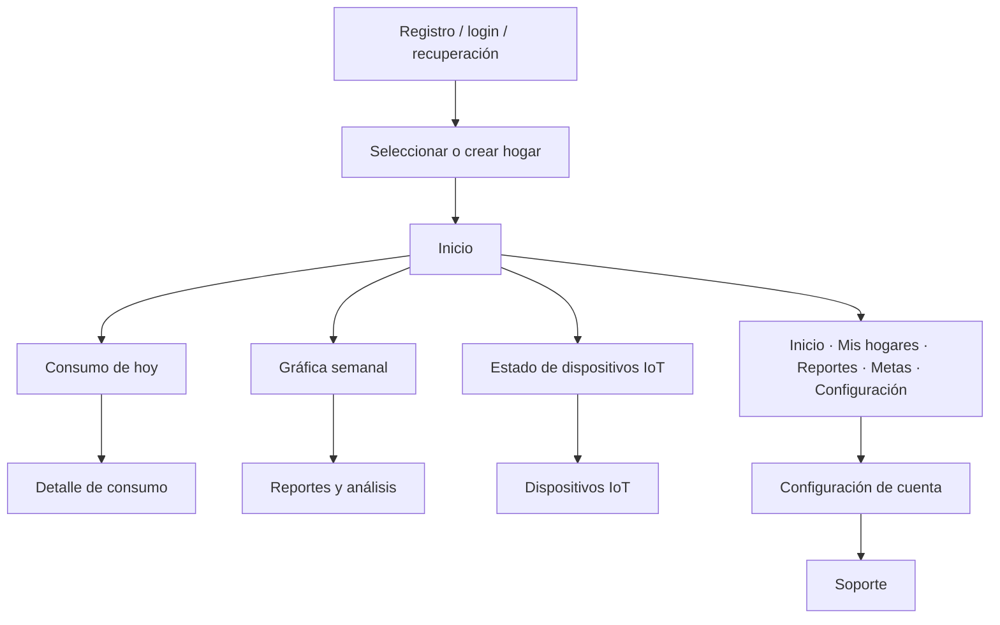

# Diseño conceptual y arquitectura de información

Este Markdown acompaña al [DOCX conservado](Dise%C3%B1o%20Conceptual%20Y%20Arquitectura%20de%20Informaci%C3%B3n.docx) en esta carpeta. Resume su intención y
separa el diseño académico propuesto de la navegación que aparece en el checkout
integrado PT_HS/hu-19-dev al 2026-11-03.

## Fuente y alcance

El DOCX describe un diseño conceptual para HidroSmart: mapa de navegación,
pantallas, perfiles y flujos alineados con requisitos. Se conserva sin editar.
Este archivo agrega una revisión de su vigencia; no sustituye la fuente original
ni afirma que todos los requisitos hayan sido implementados.

El documento fuente plantea los actores «usuario final», «técnico» y
«administrador», además de flujos para registro, consumo, recomendaciones,
registro técnico de dispositivos, administración y reportes.

## Navegación de la versión integrada revisada

La representación es textual y debe comprobarse en el cliente y rama de destino
antes de publicar una versión.

## Diferencias entre propuesta y comportamiento documentado

| Tema | DOCX conceptual | Integración revisada |
| --- | --- | --- |
| Perfiles | Usuario final, técnico, administrador como perfiles de navegación. | Los permisos se determinan en backend; hay roles globales y membresías de hogar. No se debe asumir que “técnico” es un rol de acceso implementado. |
| Inicio | Dashboard general con secciones previstas. | La pantalla móvil prioriza consumo de hoy, gráfica semanal y dispositivo IoT. |
| Navegación | Paneles separados por perfil. | Navegación móvil inferior compacta; Consumo y Dispositivos se alcanzan desde tarjetas; Soporte está dentro de Configuración. |
| Dispositivos | Registro y asignación por personal técnico. | El titular vincula un deviceCode lógico al hogar; la placa reporta hardwareId. BLE se usa para aprovisionar con un cliente compatible. |
| Recomendaciones | Se proponen como inteligentes y personalizadas. | No inferir personalización a partir del documento; verificar servicio y datos de API de la rama antes de describirlo como implementado. |
| Alertas | Se anuncian como automáticas. | Requieren reglas y umbrales activos, ingesta válida y migraciones compatibles. |
| Restablecimiento de contraseña | Flujo de cuenta descrito conceptualmente. | Consultar la guía de correo y API; una solicitud aceptada no demuestra entrega del correo. |

## Actores, permisos y seguridad

Owner/Guest describen membresías del hogar; Administrator corresponde a un rol
global de la aplicación. La etiqueta “técnico” del DOCX es un actor conceptual,
no prueba de un rol existente. La interfaz no concede permisos: la API y la base
de datos deben hacer la comprobación.

## Flujos que deben mantenerse coherentes

1. Crear cuenta, verificar correo e iniciar sesión.
2. Elegir hogar y consultar consumo/historial.
3. Vincular un dispositivo por código lógico y verificar hardwareId/estado.
4. Configurar red por BLE solo en un cliente con soporte.
5. Recibir telemetría MQTT, persistirla de forma idempotente y evaluar reglas.
6. Activar vigilancia de fuga sin apagar el sensor ni detener MQTT.
7. Desvincular dispositivo, limpiar su asociación y reactivar BLE.
8. Consultar reportes, metas, configuración y soporte según permisos.

## Control de versiones

PT_HS/hu-19-dev contiene la integración revisada. Las copias locales separadas
están en BD_HS/hu-23-dev, BK_HS/hu-15-dev, FT_HS/hu-16-staging y
Firmaware_HS/hu-03-dev. Las diferencias entre ellas se describen en
[Resumen del sistema](../../08_Documentacion_Tecnica_Actualizada/01_Resumen_y_Arquitectura/00_Resumen_del_Sistema.md).
