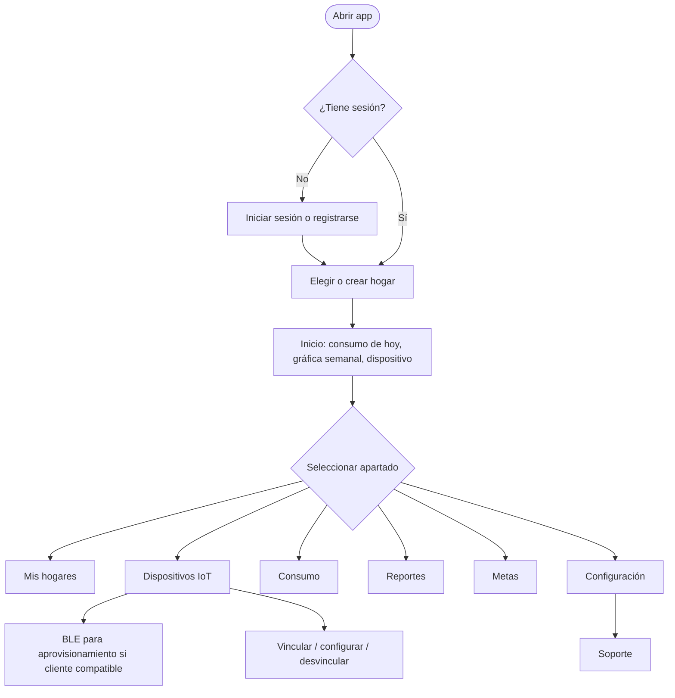

# Flujos de usuario

Mapa funcional del cliente integrado, revisado en el checkout PT_HS/hu-19-dev.
El archivo editable es [User FlowS.drawio](User%20FlowS.drawio).

En el cliente móvil documentado, la navegación inferior concentra Inicio,
Mis hogares, Reportes, Metas y Configuración; consumo y dispositivos se abren
desde las tarjetas correspondientes. Soporte está dentro de Configuración.
La disponibilidad de opciones puede depender de rol y pantalla.

Este es un mapa, no una especificación de píxeles. El Bluetooth requiere cliente
y dispositivo compatibles; Expo Go no incorpora el módulo BLE nativo.
